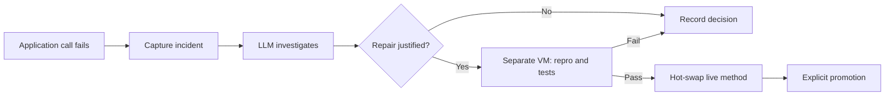

# Recast

**A Smalltalk application that uses an LLM to repair itself while it runs.**

Recast wires an LLM into a running application's exception path. A failing
call supplies the stack, method source, receiver state, and tests. The model
can propose a repair; a separate VM checks it before the application replaces
the method in its live image. Subsequent calls use the new code, without a
rebuild or restart.

The working demo is a vending machine with a deliberately broken `dispense`
method. With automatic repair enabled, an ordinary call triggers the whole
loop—no `lk heal` command or manually written repair prompt. Here is a
shortened transcript, after injecting the failure:

```text
$ ./lk eval "| vm | vm := VendingMachine make. vm insertCoin: 60. vm dispense"
ERROR: Error: automatic repair demo

$ ./lk incidents
... "status": "awaiting-model" ...
... "status": "verifying" ...
... "status": "repaired", "detail": { "ok": true, "repro": "true", ... }

$ ./lk eval "| vm | vm := VendingMachine make. vm insertCoin: 60. vm dispense"
'product'
```

The first call still fails. Investigation and verification run asynchronously;
the image applies the accepted patch, and the next call succeeds. This path
has been exercised with a real LLM through an OpenAI-compatible endpoint on
Pharo 12.

**[Take the tour in GUIDE.md](GUIDE.md)** to reproduce it: boot, edit live code,
break the app, trigger automatic repair, and promote the result. You can also
use the [offline fake LLM](GUIDE.md#offline-path-use-the-fake-llm) without an
API key; it supplies canned proposals through the same verification path.

## Why this experiment?

An application's runtime has useful evidence about a failure: the call stack,
the receiver's state, and the code that actually ran. Recast turns that evidence
into a repair request and connects the result to a live deployment mechanism.
The experiment is how much of an application's maintenance loop can become
part of the application itself.

Smalltalk is a useful substrate because classes, methods, and execution
contexts are objects the running system can inspect. Compile a replacement
method into a class, and subsequent message sends use it immediately. The
existing application objects keep their identity; applying a method patch
does not require rebuilding their world.

Recast adds a verification and persistence policy around that capability:
test the proposal in another VM, apply it tentatively, and explicitly promote
the definitions that should survive restart. The LLM proposes; the runtime
checks and applies.

The example is intentionally small: one demo class, method replacements,
receivers with simple literal state, and two application tests. It demonstrates
the mechanics of automatic repair, not general autonomous software maintenance.
A green test run establishes only what those tests check.

## How it works



1. **Capture.** `LLMRepairService` observes an error at the application's eval
   boundary, before it becomes an error string. For an opted-in application
   class, it captures the failing method, stack, source, simple receiver state,
   arguments, existing tests, and the class's repair contract. It constructs a
   repro using a fresh receiver with the captured state.
2. **Investigate.** The Python supervisor sends that evidence to the model.
   The model returns `expected`, `insufficient-evidence`, or `repair`, with a
   reason. A raised exception alone does not require a patch.
3. **Verify.** The image parses a repair proposal and permits only a replacement
   of the captured application method. A separate Pharo VM loads the kernel,
   replays the journal, applies the candidate, and runs the repro and suite.
4. **Apply.** A passing verdict lets the live image compile the replacement and
   journal it. The failed operation is never automatically retried. Promotion
   remains a separate operator action.

The application queue and heartbeat continue while the model and shadow VM
work. Repeated failures from an unchanged method are deduplicated. A code edit
invalidates an outstanding proposal; disabling repair or restarting cancels
pending work. `lk incidents` records decisions and verification results, and
`data/heal/req-N.json` / `resp-N.json` preserve the captured evidence and replies.

Automatic repair defaults to off and currently opts in `VendingMachine`.
Expected insufficient-credit errors, compilation errors, test runs, boot
replay, and shadow evaluation do not start investigations. Another application
class can opt in through `repairClasses` in kernel configuration and a
`repairContract` class method; `repairExpectedErrors` lists error messages to
exclude.

## Run it

You need Git, Docker with the Compose plugin, Python 3, and an API key for an
OpenAI-compatible Chat Completions endpoint. From a fresh checkout:

```bash
git clone https://github.com/rot13maxi/recast.git
cd recast
cp .env.example .env
# Edit .env: set your endpoint, model, and LIVE_LLM_API_KEY.
docker build -f Dockerfile.base -t live-smalltalk-base:latest .
docker compose up -d --build
./lk status
./lk tests
```

The template uses `https://api.openai.com/v1/chat/completions` with
model `current`, the endpoint used for validation. Other compatible providers
and local models can be configured with the supervisor's request format; the
GUIDE explains
the configuration and includes a connection check from inside the container.
If `.env` already exists, edit it instead of overwriting it. It is ignored by Git.
The first build downloads Pharo and its dependencies.

Continue with [the GUIDE](GUIDE.md) for the failure-to-repair experiment.
The command-line interface also exposes each part of the loop:

| Command | Purpose |
|---------|---------|
| `./lk eval "..."` | Evaluate code or compile definitions directly in the live VM |
| `./lk autorepair on` / `off` | Enable or disable incident-driven repair |
| `./lk incidents` | Inspect automatic investigations and their outcomes |
| `./lk candidate fix.st --repro repro.st` | Verify a patch without applying it |
| `./lk heal --problem "..." --repro repro.st --target VendingMachine` | Request a repair explicitly |
| `./lk tests` | Run the registered application tests |
| `./lk promote` | Make journalled definitions survive restart if tests pass |
| `./lk rollback 2` | Set the journal prefix to replay on the next boot |

For explicit `lk heal`, the model receives the supplied problem and repro
without the automatic incident's source and state capture. Include the
relevant fields and intended behavior in the problem description. This path
is an [optional experiment in the GUIDE](GUIDE.md#5-optional-request-a-repair-explicitly).

## State and restart

The live image never saves a heap snapshot. Each boot loads the base image,
installs the kernel, replays the promoted journal prefix, and starts the queue.
Mutable files live in `/data`, bind-mounted from the host's `data/` directory:

| File | Purpose |
|------|---------|
| `journal.json` | Ordered sources for successful definition edits |
| `marker.json` | `{n}`: the first `n` journal entries are promoted |
| `config.json` | Kernel settings, including `automaticRepair` and `repairClasses` |
| `tests.json` | Registered test class names |
| `incidents.json` | Automatic investigations and their outcomes |
| `healed.json` | Successful repairs |

Definitions beyond the marker are tentative. Restart leaves them unapplied;
`lk promote` runs the suite and advances the marker to the journal size if it
passes. `lk rollback <n>` chooses an earlier prefix for the next boot.
The journal restores definitions, not application data or in-memory objects.

## What has been checked

Real-model runs exercised both automatic and explicit repair. The proposed
vending-machine fixes passed the shadow repro and application suite and were
applied live. Promotion and restart preserved a repair; an unpromoted edit
was left unapplied after restart.

Deterministic integration checks cover rejected candidates, patches outside
the allowed method, stale proposals, duplicate suppression, expected failures,
declined investigations, and cancellation. A deliberately slow shadow run
leaves the application queue and heartbeat responsive. The offline endpoint
returns predefined patches; those checks test the mechanism, not model quality.
There is no repair success-rate benchmark here.

To rerun the checks against a demo stack:

```bash
python3 -m unittest discover -s test -p 'test_*.py'
docker compose stop supervisor
python3 test/auto_repair.py
docker compose start supervisor
```

The integration script makes tentative edits, restores the vending method
and automatic-repair setting, and leaves its journal entries and audit trail.

## Where it stops

- **Verification depends on tests.** The demo has two application tests. The
  model gets an application contract, but that prose is not an independent
  executable verifier. Stronger tests and independent specifications matter.
- **The shadow VM is not a sandbox.** Candidate code can access shared files
  and runtime facilities. Restricting which method can be replaced does not
  constrain everything its body can do. Hostile proposals need stronger
  process and filesystem isolation.
- **Repair does not undo side effects.** Receiver state is captured at failure
  time. The failed call may already have changed state, so it is never blindly
  retried. Complex object graphs are skipped.
- **Method repair is narrower than state migration.** Changing instance-variable
  layouts or assumptions about existing objects needs migration machinery.
  Passing tests in a fresh VM does not establish the live heap's compatibility.
- **Replay is code persistence.** Application data needs separate storage.

The next experiments are stronger isolation, independent tests, canary traffic,
and explicit support for state migration and operations that can be retried.

## Implementation map

| File | Role |
|------|------|
| `kernel/gen_methods.py` | Generates the kernel sources and installer |
| `kernel/repair_methods.py` | Incident capture and automatic repair state machine |
| `kernel/methods.json` | Generated Smalltalk method sources |
| `kernel/boot_eval.st` | Kernel installation, replay, and queue startup |
| `agent/supervisor.py` | LLM requests and investigation decisions |
| `scripts/shadow_run.sh` | Candidate evaluation in a separate VM |
| `lk` | Host CLI using the file queue |
| `test/auto_repair.py` | Live integration checks with the supervisor stopped |
| `test/test_supervisor.py` | Response parsing and publication checks |
| `test/fakellm.py` | Offline OpenAI-compatible fixture server |
| `Dockerfile.base` / `Dockerfile` / `docker-compose.yml` | Pharo base image and demo stack |

When extending the kernel, edit the Python sources and run
`python3 kernel/gen_methods.py`. The installer creates classes before compiling
methods; method sources are stored as JSON strings to avoid manual quote
escaping. Boot and shadow replay avoid live-side effects such as incident
capture and automatic test registration.
