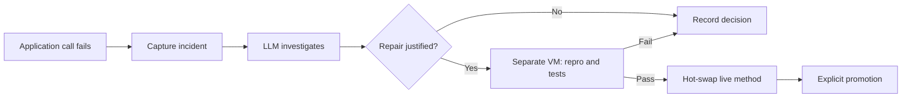

# Recast

**An experiment in applications that can investigate their own failures and
install tested repairs while they keep running.**

Recast connects an LLM to a running Pharo Smalltalk application.
When an application call fails, the runtime can capture what happened, ask the
model whether a repair is justified, test its proposal in a separate VM, and
replace the failing method in the live application. The next call uses the
repaired behavior. No rebuild or restart is needed to apply it.

The question behind the project is how much of an application's maintenance
loop can live inside its runtime. An exception supplies a concrete starting
point: a failing method, a receiver, a stack, and an operation to reproduce.
An LLM can reason about that evidence and the application's contract. The
runtime can test its proposed change against the repro and existing tests.

## Why Smalltalk?

Smalltalk makes code part of a live world of objects. Classes and methods can
be inspected and changed while the program runs, and subsequent message sends
use the newly compiled methods. That gives an LLM both evidence about a failure
and a place to apply a repair without taking the application down.

This project combines that capability with a deployment process: verify in a
separate VM, apply a tentative change, and explicitly promote the definitions
that should survive restart. It makes a small, working experiment possible:
an ordinary failing call can lead to a verified change in the running program.

The demo is a vending machine. Break its `dispense` method, insert enough
credit, and ask it to dispense. The call returns its error. With automatic
repair enabled, that failure also starts an LLM investigation. After the
proposal passes verification, the same operation returns `'product'`.
This has been exercised with a real model, a real model, on Pharo 12.

**[Take the tour in GUIDE.md](GUIDE.md)** to boot the application, hot-swap code,
break and repair it, enable automatic investigation, and prove that promoted
changes survive restart. You can also take the tour without an API key using
the [offline fake LLM](GUIDE.md#offline-path-use-the-fake-llm).

This is a research prototype. Automatic repair is opt-in and currently scoped
to the vending-machine demo. Verification checks the repro and existing tests;
its guarantees depend on their coverage and on the shadow VM's isolation.
The implementation and remaining limits are described below.

## The repair loop



`LLMRepairService` captures unexpected application errors and queues the
investigation. The caller receives the original error immediately. The model
can propose a repair, identify an expected failure, or report insufficient
evidence. Model requests and shadow verification run outside the queue's
execution of the application call.

The image accepts an automatic proposal only if it replaces the captured
application method and passes the shadow checks. Later calls use the repaired
method; the original operation is never automatically retried. The image also
records the decision and result for inspection with `lk incidents`.

You can use the same deployment machinery directly: `lk heal` requests a
repair, `lk candidate` verifies source without applying it, and `lk eval`
edits the live image immediately. `lk promote` chooses which journalled
definitions survive restart.

## State and promotion

The image never saves a snapshot. It rebuilds from a base image and the files
in `/data` (bind-mounted from the host's `data/` directory):

| File | Purpose |
|------|---------|
| `journal.json` | Ordered sources for successful definition edits |
| `marker.json` | `{n}`: the first `n` journal entries are promoted |
| `config.json` | Kernel settings, including `automaticRepair` and `repairClasses` |
| `healed.json` | Successful self-heal history |
| `incidents.json` | Automatic investigations and their outcomes |
| `tests.json` | Registered test class names |

Each boot loads `base.image`, installs the kernel from `kernel/methods.json`,
replays `journal[1..marker]`, and starts the queue REPL. The supervisor's LLM
endpoint is configured separately through the `LIVE_LLM_*` environment
variables in Compose.

- **Hot-swap:** `lk eval` compiles code into the running VM. Successful sources
  recognized as definitions are appended to the journal.
- **Tentative change:** an entry beyond the marker is active until restart.
  Restart rebuilds from the promoted prefix, leaving that change unapplied.
- **Promote:** `lk promote` runs the suite and, if it passes, sets the marker
  to the journal size. Those definitions now survive restart.
- **Rollback:** `lk rollback <n>` moves the marker. Restart to rebuild from
  that prefix.

The journal records code definitions, not the contents of the live heap.
This makes code changes replayable; application data still needs its own
storage.

## Running it

Use Docker with the Compose plugin and Python 3. From the repository root,
build the Pharo base image once, configure the endpoint, and start the stack:

```bash
cp .env.example .env
# Edit .env and fill in LIVE_LLM_API_KEY.
docker build -f Dockerfile.base -t live-smalltalk-base:latest .
docker compose up -d --build
./lk status
./lk tests
```

Compose loads the endpoint, model, and key from `.env`. The template uses
`https://api.openai.com/v1/chat/completions` with model `current`.
Other OpenAI-compatible endpoints can be used with a model that accepts the
supervisor's request format. The GUIDE covers endpoint checks and the
[offline alternative](GUIDE.md#offline-path-use-the-fake-llm).

Common commands:

```bash
./lk eval "VendingMachine compile: 'price: amount price := amount'. nil"
./lk candidate fix.st --repro repro.st    # verify without applying
./lk heal --problem "..." --repro repro.st --target VendingMachine
./lk promote                            # persist definitions if tests pass
./lk rollback 2                         # replay entries 1..2 on next boot
./lk reset --yes                        # erase data and restart fresh
```

## How explicit self-healing works

1. The image writes `/data/heal/req-N.json` with
   `{id, problem, repro, target, journalSize}`.
2. `agent/supervisor.py` reads the request, calls the LLM, and writes
   `/data/heal/resp-N.json` with `{id, source}`.
3. `Supervisor>>testCandidate:repro:` starts a separate VM from the base
   image, replays the journal, applies the candidate, evaluates the repro,
   and runs the suite.
4. If the verdict is green, the live image evaluates the source and journals
   the change. Promotion remains a separate step.

For `lk heal`, the model receives the problem text and repro without an
automatic dump of the target's source code.
Include the relevant fields and intended behavior in the problem description,
as the GUIDE's repair request does.

### Automatic repair

`./lk autorepair on` lets an ordinary failing application call start that loop.
`LLMRepairService` captures the exception before it is reduced to an error
string, including the application frame, method source, stack, primitive
receiver state, tests, and the class's repair contract. The caller receives
its original error; the LLM investigation and shadow verification proceed
asynchronously. Later calls use an accepted patch. Promotion is still explicit.

The model can report an expected failure, insufficient evidence, or a repair.
Automatic proposals must compile only the captured application method. Changed
code invalidates an outstanding proposal, repeated failures from the same
method are deduplicated, and disabling repair cancels pending work. The
[automatic-repair demo](GUIDE.md#automatic-repair-from-an-ordinary-call)
shows the full path with a real model.

Automatic repair defaults to off. It currently covers instance methods on
`VendingMachine`, which declares `repairContract` and `repairExpectedErrors`
on its class side. Expected insufficient-credit errors, compilation errors,
boot replay, tests, and shadow evaluations do not trigger investigations.
`./lk incidents` shows decisions and verification results; `./lk autorepair off`
stops automatic application of proposals. To opt in another application class,
add its name to `repairClasses` in kernel configuration and define its
`repairContract` class method. `repairExpectedErrors` optionally lists expected
error messages to exclude.

The first version reconstructs receivers and arguments containing small
literal values. It skips complex object graphs and does not retry the failed
operation. A receiver snapshot is taken at failure time, so it does not undo
side effects that already occurred. Method-body execution retains the shadow
isolation limits described below.

## Evidence

The repository's lifecycle checks exercise these behaviors with live
containers. The fake endpoint supplies deterministic proposals for the
repair and rejection cases; it does not test a model's ability to write a fix.

The GUIDE's real-LLM path has also been run with a real model.
Its generated repair passed shadow verification and the live suite, was
promoted, and survived restart. The tentative-edit restart check passed too.

| Check | Expected result |
|-------|-----------------|
| Define a class with `lk eval`, then use it in the next job | Available immediately, without restart |
| Promote while a test fails | `ok=false`, promotion refused |
| Restart after promotion | Promoted definitions replayed |
| Restart after a tentative edit | Promoted behavior restored |
| Verify a good candidate | `ok=true`, live image untouched |
| Verify a patch that breaks a test | `ok=false`, live image untouched |
| Verify a candidate against a failing repro | `ok=false` |
| Supervisor returns a sabotage patch | `ok=false, stage=shadow-verify-failed` |
| Candidate does not compile | Rejected by the candidate-apply check |
| Repair a broken `dispense` method | Verified patch applied; live suite green |
| Define a new `*Tests` class through `lk eval` | Added to the registry; failures block promotion |

The automatic path has also passed checks for duplicate suppression, expected
failures, declined investigations, stale proposals, cancellation, patch scope,
and rejected candidates. A deliberately slow shadow run leaves queue calls
and the heartbeat responsive. To rerun the deterministic checks against a
demo stack (the integration script makes tentative edits and restores the
vending method and repair setting):

```bash
python3 -m unittest discover -s test -p 'test_*.py'
docker compose stop supervisor
python3 test/auto_repair.py
docker compose start supervisor
```

## Pharo 12 headless notes

These details matter when extending the kernel or writing patches:

- **Define and use a class in separate evals.** A literal class name must exist
  when the expression compiles. If you need both operations in one eval,
  look it up with `Smalltalk globals at: #Foo`. The kernel installer creates
  classes in one pass and compiles methods in a second.
- **Use `Transcript show: ...; cr; flush` for output.** Pharo 12 strings do
  not understand `displayNl`, `printNl`, or `puts`.
- **Use `pharo --headless IMAGE eval "<expression>"` for startup.** `loadst`
  reopens the image after loading and can leave a headless process running.
  The kernel loads through one generated eval.
- **Keep the `.sources` file beside the image.** Snapshot/save operations can
  abort without it.
- **Double single quotes inside Smalltalk strings.** Method source passed to
  `compile:` is itself a string. The kernel avoids manual escaping by storing
  those sources as JSON strings in `kernel/methods.json`, generated by
  `gen_methods.py`.
- **Wrap multi-statement evals in a block.** `LiveKernel>>evalQuiet:` uses
  `'[' , src , '] value'` and returns caught errors as text.
- **Journal only successful definition edits.** Sources returning `ERROR:`,
  `EXCEPTION:`, or `NOTIFICATION:` are excluded from the journal.
- **Parse verdicts as JSON.** Searching for `"ok":true` can mistake a nested
  test result for the overall verdict.
- **Use `FileReference entries` with `isFile`** when listing files; the
  `entries` and `directoryEntries` APIs differ.
- **Register test classes only on the live edit path.** `lk tests` uses the
  explicit registry in `tests.json`. A global sweep would include Pharo's
  internal test classes. After a successful definition edit, `eval:` registers
  newly added classes whose names end in `Tests`. Boot replay and shadow
  evaluation avoid this side effect, so a rejected candidate cannot add its
  test class to the live registry through automatic registration.

## Limits and next steps

The prototype demonstrates a useful deployment loop for agent-maintained
services: edit a running system, verify proposed repairs in another VM, and
choose which definitions survive restart. It is especially useful for
exploring frequent method changes in long-running applications.

Several problems remain before this could support a production service:

- **State migration:** replacing a method is straightforward; changing a
  class's instance variables or assumptions about existing objects needs
  explicit migration. A green suite in a fresh VM does not verify the live
  heap's state.
- **Test coverage and independence:** passing tests establishes only what
  those tests check. An agent that writes both a feature and its tests can
  satisfy an inadequate specification. Independent tests and traffic-based
  checks would strengthen the gate.
- **Isolation:** a separate VM is an execution check, not a security boundary.
  Candidate code has access to shared files and runtime facilities. Hostile
  proposals require stronger process and filesystem isolation.
- **Data persistence:** journal replay restores definitions. In-memory
  application state is lost on restart and must be stored elsewhere.
- **Headless tooling:** the Pharo workflow works here, but startup, output,
  and source loading need the conventions listed above.

Next steps are instance-migration hooks, a canary VM that exercises candidate
code with traffic, independent test generation, and tighter shadow isolation.

## Layout

```
GUIDE.md                lifecycle walkthrough (start here)
kernel/gen_methods.py   generates methods.json + install/boot .st (edit this)
kernel/repair_methods.py automatic incident capture and repair state machine
kernel/methods.json     the kernel's Smalltalk sources (generated)
kernel/boot_eval.st     the single eval that boots the container
scripts/serve.sh        container CMD: fresh image + boot + queue REPL
scripts/shadow_run.sh   runs a generated driver in a separate VM
agent/supervisor.py     the LLM side (proposes; never applies)
test/fakellm.py         canned OpenAI-compatible endpoint for offline testing
test/auto_repair.py     live integration checks (supervisor stopped)
test/test_supervisor.py investigation-response parsing and publication checks
lk                      host CLI: the file-queue client
Dockerfile.base         Pharo 12 VM+image (cached layer)
Dockerfile              application image (kernel + scripts)
docker-compose.yml      prod + supervisor, /data bind-mounted
```
